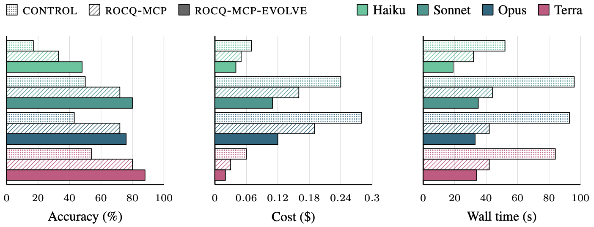

# rocq-mcp-evolve

[](https://github.com/LLM4Rocq/rocq-mcp-evolve/actions/workflows/ci.yml)
[](https://llm4rocq.github.io/rocq-mcp-evolve/)

rocq-mcp-evolve is an MCP server for the Rocq proof assistant.
It is entirely written in OCaml on top of the Rocq runtime API.
The server maintains a live interactive session with the agent: it enables the agent to apply tactics to advance the proof state, to backtrack, and to access the current proof state, exposes simple automation tools that can be used to close simple proof goals, and exposes verification tools to check the validity of a proof or of an entire project.

On the held-out `test` split of miniF2F-Rocq, an agent equipped with rocq-mcp-evolve outperforms both the baseline that only exposes the Rocq compiler (control) and an established MCP server ([rocq-mcp](https://github.com/LLM4Rocq/rocq-mcp)), across four models from two families (Claude Haiku 4.5, Claude Sonnet 5, Claude Opus 4.8, and GPT-5.6 Terra). Here are the results for all three metrics: the *accuracy* (the success rate), the *cost* per solve, and the *wall time* per solve.



## Using the server

```sh
opam pin add rocq-mcp-evolve https://github.com/LLM4Rocq/rocq-mcp-evolve.git
```

```json
{ "mcpServers": { "rocq": { "command": "rocq-mcp-evolve" } } }
```

No further configuration is needed: the server installs the `rocq-runtime` 9.1 or 9.2 dependency automatically and discovers the project load paths from your `_CoqProject`, `_RocqProject` or `dune-project`, so build your project first.
The agent calls `open` on a file (optionally with a theorem name), works the proof with the other tools, and on completion receives the finished script to insert into your file.

## The tools

| tool                   | what it does                                                                                        |
| ---------------------- | --------------------------------------------------------------------------------------------------- |
| `open{file, theorem?}` | Opens a `.v` file and starts (or restarts) a session on a theorem or on the trailing open goal.     |
| `build{file}`          | Diagnoses a whole file in one call: all broken proofs at once.                                      |
| `check{script}`        | Submits a complete proof in one call; on failure the agent stands at the failing sentence.          |
| `step{text}`           | Executes sentences incrementally; each success is committed, the first failure is reported.         |
| `try{candidates}`      | Tests up to 8 candidate scripts speculatively; the first full success is committed.                 |
| `auto_close{}`         | Runs the standard finisher portfolio (`lia`, `lra`, `nra`, `nia`, `ring`, ...) on the current goal. |
| `rollback{count}`      | Undoes the last N committed sentences.                                                              |
| `state{}`              | Re-renders the open goals and the committed proof.                                                  |

Every tool response carries information from the prover at no extra turn: error hints rewrite common mistakes into the Rocq form, unknown references come with the nearest existing lemma names, and `auto_close` asserts auxiliary facts before retrying the nonlinear finishers.
Every sentence runs under a timeout, so a diverging computation returns an error instead of freezing the session, and the standard tactic modules (`Lia`, `Lra`, `Psatz`) are preloaded after the statement.
All tools and features are on by default: trim the tools with `ROCQ_ENABLE_TOOLS=step,state,...` and disable features with `ROCQ_HINTS=0`, `ROCQ_SUGGEST=0`, `ROCQ_AUTO2=0` or `ROCQ_PRELOAD=0`.
The rationale of each tool is in [`RATIONALE.md`](RATIONALE.md).

## How the server was built

We propose an evolutionary method building an MCP server for the Rocq proof assistant.
We start with a basic MCP server exposing only the Rocq compiler.
At each step, a frontier model *mutates* the existing MCP server by adding a new feature, *evaluates* this new server with smaller models, and only keeps mutations that improve overall performance.
The rationale of each decision is in [`RATIONALE.md`](RATIONALE.md).
The GitHub repository of the entire experiment is available at https://github.com/LLM4Rocq/rocq-mcp-evolve-experiment and the corresponding paper can be found at https://arxiv.org/abs/2609.39544.

## Repository map

- `src/session_server/`: rocq-mcp-evolve. It is entirely written in OCaml on top of the Rocq runtime API. The server maintains a live interactive session with the agent: it enables the agent to apply tactics to advance the proof state, to backtrack, and to access the current proof state, exposes simple automation tools that can be used to close simple proof goals, and exposes verification tools to check the validity of a proof or of an entire project.
- `src/mcp_core/`: the MCP stdio framework used by the servers.
- `src/psession/`: the shared-proof daemon and shim for several agents on one proof.
- `test/`: the integration suites, run with `dune runtest` (see `test/ARCHITECTURE.md`).
- `RATIONALE.md`: the design rationale.

## How to cite

```bibtex
@software{rocqmcpevolve2026,
  author = {{LLM4Rocq}},
  title  = {rocq-mcp-evolve: an {MCP} server for {Rocq}, evolved by measured design search},
  year   = {2026},
  url    = {https://github.com/LLM4Rocq/rocq-mcp-evolve}
}
```
